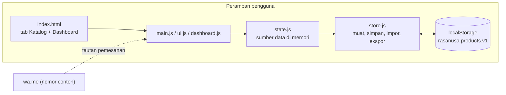
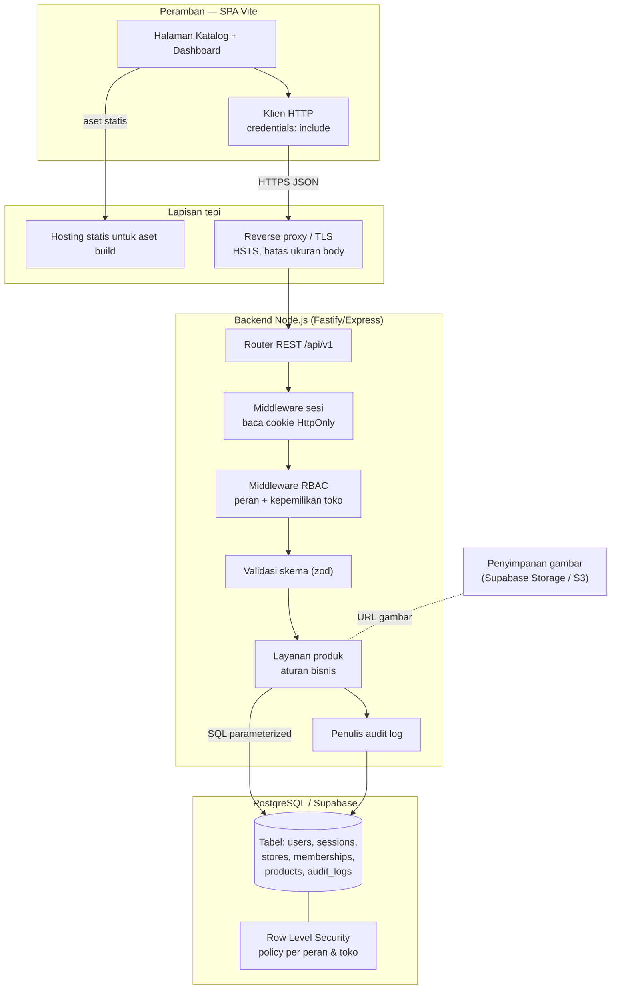
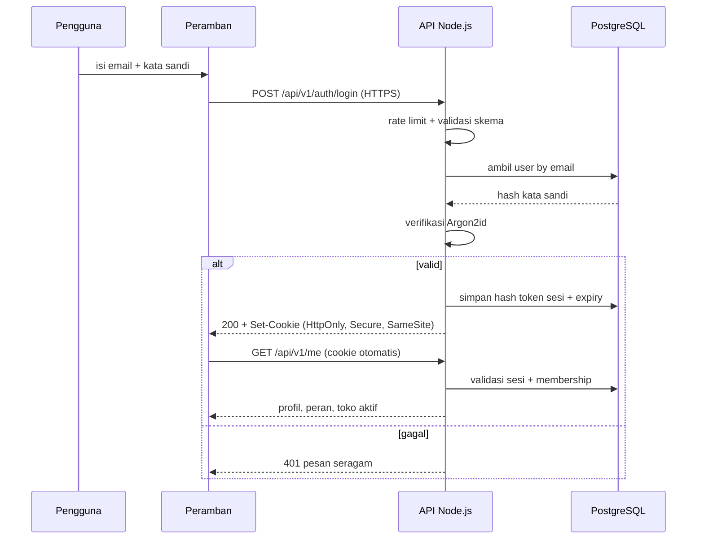

# ARCHITECTURE.md — Rencana Migrasi JahitSuka ke Backend

Dokumen ini hanya **rencana**. Aplikasi yang berjalan sekarang tetap 100% statis: Vite, JavaScript vanilla, dan `localStorage`. Tidak ada backend, database, maupun login pada implementasi saat ini.

| Status | Nilai |
| --- | --- |
| Versi aplikasi kini | Demo statis, data di `localStorage` (`rasanusa.products.v1`) |
| Target | Node.js API + PostgreSQL/Supabase, multi-toko, autentikasi server |
| Ruang lingkup dokumen | Arsitektur, keamanan, urutan migrasi, kriteria verifikasi |
| Bukan bagian dokumen | Kode backend, skema login sementara, payment gateway |

---

## 1. Kondisi Saat Ini



Karakteristik penting:

- Satu perangkat, satu pengguna; tidak ada identitas, peran, atau pemilik data.
- Validasi hanya di klien (`validate.js`), sehingga dapat dilewati lewat DevTools.
- Katalog publik dan dashboard berbagi satu state (`state.js`) dan kunci penyimpanan yang sama.
- Nomor WhatsApp adalah data konfigurasi nonrahasia di frontend.

Yang **tidak** boleh dibawa ke produksi: kepercayaan penuh pada validasi klien, penyimpanan data bisnis di peramban, dan tidak adanya audit.

---

## 2. Arsitektur Target



Prinsip arsitektur:

1. **Server adalah otoritas.** Semua validasi, otorisasi, dan penentuan pemilik data terjadi di server. Klien hanya menampilkan.
2. **Satu sumber kebenaran.** PostgreSQL; `localStorage` hanya cache sementara (opsional) saat migrasi.
3. **Setiap baris tahu pemiliknya.** `store_id` wajib pada tabel data bisnis.
4. **Semua akses data lewat service**, bukan query ad-hoc di route handler.
5. **Semua aktivitas penting tercatat** di `audit_logs`.

---

## 3. Backend Node.js sebagai API

Rekomendasi: **Fastify** (performa, validasi skema bawaan) atau Express bila tim lebih familiar. Bahasa tetap JavaScript/TypeScript; TypeScript disarankan untuk kontrak API.

### 3.1 Endpoint awal

| Method | Path | Akses | Fungsi |
| --- | --- | --- | --- |
| `POST` | `/api/v1/auth/login` | publik + rate limit | Buat sesi, set cookie |
| `POST` | `/api/v1/auth/logout` | sesi aktif | Cabut sesi, hapus cookie |
| `GET` | `/api/v1/me` | sesi aktif | Profil + peran + toko aktif |
| `GET` | `/api/v1/public/stores/:slug/products` | publik | Katalog publik (hanya field tampilan) |
| `GET` | `/api/v1/products` | `owner`/`staff` | Daftar produk toko aktif |
| `POST` | `/api/v1/products` | `owner` (staff opsional) | Tambah produk |
| `PATCH` | `/api/v1/products/:id` | `owner`/`staff` pemilik toko | Ubah produk |
| `DELETE` | `/api/v1/products/:id` | `owner` | Hapus produk (soft delete) |
| `GET` | `/api/v1/audit-logs` | `owner` | Riwayat aktivitas toko |
| `POST` | `/api/v1/stores/:id/members` | `owner` | Undang staf + tetapkan peran |

### 3.2 Bentuk respons

```json
{
  "data": [
    {
      "id": "b0f1c1f0-8b5e-4a0e-9e7f-2f3b0c9d1a11",
      "nama": "Kebaya Modern Bordir",
      "kategori": "Wanita",
      "harga": 450000,
      "stok": 6,
      "deskripsi": "Kebaya potong modern dengan bordir bunga.",
      "imageUrl": "/images/kebaya.svg",
      "unggulan": true,
      "updatedAt": "2026-11-19T09:12:00.000Z"
    }
  ],
  "meta": { "total": 1, "page": 1, "perPage": 50 }
}
```

Kesalahan memakai status HTTP yang benar dan bentuk konsisten:

```json
{ "error": { "code": "VALIDATION_ERROR", "message": "Harga tidak valid.", "fields": { "harga": "Harga minimal 0." } } }
```

---

## 4. Database PostgreSQL / Supabase

### 4.1 Skema inti

```sql
create table stores (
  id uuid primary key default gen_random_uuid(),
  slug text unique not null,
  nama text not null,
  created_at timestamptz not null default now()
);

create table users (
  id uuid primary key default gen_random_uuid(),
  email citext unique not null,
  password_hash text not null,          -- Argon2id
  email_verified_at timestamptz,
  created_at timestamptz not null default now()
);

create type peran_toko as enum ('owner', 'staff', 'viewer');

create table memberships (
  user_id uuid not null references users(id) on delete cascade,
  store_id uuid not null references stores(id) on delete cascade,
  peran peran_toko not null default 'staff',
  created_at timestamptz not null default now(),
  primary key (user_id, store_id)
);

create table sessions (
  id uuid primary key default gen_random_uuid(),
  user_id uuid not null references users(id) on delete cascade,
  token_hash text unique not null,       -- hash SHA-256 token, bukan token mentah
  expires_at timestamptz not null,
  ip text,
  user_agent text,
  created_at timestamptz not null default now()
);

create table products (
  id uuid primary key default gen_random_uuid(),
  store_id uuid not null references stores(id) on delete cascade,
  nama text not null check (char_length(btrim(nama)) between 3 and 70),
  kategori text not null check (kategori in ('Wanita','Pria','Seragam','Permak','Aksesori')),
  harga numeric(12,2) not null check (harga >= 0),
  stok integer not null check (stok >= 0),
  deskripsi text not null check (char_length(btrim(deskripsi)) between 5 and 240),
  image_url text not null default '',
  unggulan boolean not null default false,
  deleted_at timestamptz,
  created_at timestamptz not null default now(),
  updated_at timestamptz not null default now()
);

create index products_store_idx on products (store_id) where deleted_at is null;

create table audit_logs (
  id bigserial primary key,
  store_id uuid references stores(id) on delete set null,
  actor_user_id uuid references users(id) on delete set null,
  aksi text not null,
  entitas text not null,
  entitas_id text,
  metadata jsonb not null default '{}'::jsonb,
  ip text,
  created_at timestamptz not null default now()
);
```

Catatan: `harga numeric` menghindari galat pembulatan; validasi klien tetap irit karena hanya lapisan UX. ID publik memakai UUID agar tidak mudah ditebak (menggantikan `p-lx3k9a2f`).

### 4.2 Isolasi data berdasarkan pemilik toko

Tiga lapis, semuanya wajib:

1. **Lapis query** — setiap query menyertakan `where store_id = $storeId`; `$storeId` diambil dari sesi + membership, **tidak pernah** dari body/query string.
2. **Lapis RLS** — kebijakan database menolak baris di luar toko pengguna, sehingga bug query tetap tidak membocorkan data.
3. **Lapis peran** — `staff` hanya boleh mengubah, `viewer` hanya membaca, `owner` boleh menghapus dan mengundang anggota.

---

## 5. Autentikasi yang Aman

- Hash kata sandi dengan **Argon2id** (memory 64 MB, iterations 3, parallelism 2) atau bcrypt cost ≥ 12.
- Email harus diverifikasi sebelum dashboard aktif; tautan verifikasi sekali pakai dan berbatas waktu.
- Login dibatasi **rate limit** per IP + per akun (mis. 5 percobaan/menit, backoff eksponensial).
- Pesan gagal login seragam ("Email atau kata sandi salah") untuk mencegah enumerasi akun.
- Opsional namun disarankan: MFA TOTP untuk peran `owner`.
- Sesi disimpan di server (`sessions`), token acak 256-bit; yang disimpan hanya hash-nya.
- Perpanjangan sesi dengan rotasi token (sliding expiration) dan pencabutan semua sesi saat ganti kata sandi.
- Jangan menyimpan token sensitif di `localStorage` — itulah alasan sesi memakai cookie.

### 5.1 Session cookie

```
Set-Cookie: sid=<token>; HttpOnly; Secure; SameSite=Lax; Path=/; Max-Age=604800
```

| Atribut | Alasan |
| --- | --- |
| `HttpOnly` | JavaScript tidak bisa membaca token → XSS tidak langsung mencuri sesi. |
| `Secure` | Hanya dikirim lewat HTTPS. |
| `SameSite=Lax` | Memblokir sebagian besar CSRF lintas situs; `Strict` bisa dipilih bila tidak butuh deep link. |
| `Path=/` | Sesi berlaku untuk API dan halaman. |
| `Max-Age` | Masa hidup terbatas (mis. 7 hari), diperbarui saat aktif. |
| `__Host-` prefix | Opsional: `__Host-sid` memaksa `Secure`, `Path=/`, tanpa `Domain`. |

CSRF tambahan: token ganda (cookie non-HttpOnly + header `X-CSRF-Token`) atau pemeriksaan `Origin`/`Referer` untuk semua request mutasi.

### 5.2 Alur autentikasi



Frontend **tidak** menyimpan status login di `localStorage` dan tidak pernah memercayai flag peran di klien; setiap request otorisasi dihitung ulang di server.

---

## 6. RBAC

Peran melekat pada **keanggotaan toko** (`memberships.peran`), bukan pada pengguna global, sehingga satu pengguna bisa menjadi `owner` di toko A dan `staff` di toko B.

| Aksi | owner | staff | viewer |
| --- | --- | --- | --- |
| Lihat produk toko | ya | ya | ya |
| Tambah produk | ya | ya | tidak |
| Ubah produk | ya | ya | tidak |
| Hapus produk | ya | tidak | tidak |
| Undang/cabut anggota | ya | tidak | tidak |
| Lihat audit log | ya | tidak | tidak |

Implementasi:

```js
// Middleware server — bukan dapat dilewati dari klien
function butuhPeran(...peran) {
  return async (req, reply) => {
    if (!req.sesi) return reply.code(401).send({ error: { code: 'UNAUTHENTICATED' } });
    const membership = await db.memberships.find(req.sesi.userId, req.tokoAktifId);
    if (!membership || !peran.includes(membership.peran)) {
      return reply.code(403).send({ error: { code: 'FORBIDDEN' } });
    }
    req.membership = membership;
  };
}

app.delete('/api/v1/products/:id', { preHandler: butuhPeran('owner') }, hapusProduk);
```

Toko aktif ditentukan lewat header `X-Store-Id` (UUID) yang **selalu** diverifikasi terhadap `memberships`; toko di luar keanggotaan → `403`/`404`.

---

## 7. Validasi Input di Server

- Semua body/query divalidasi skema (zod/Joi) sebelum menyentuh database; tipe ketat, batas panjang, enum kategori, angka >= 0, integer stok.
- Gunakan prepared statement/parameterized query — dilarang menyusun SQL dengan string body.
- Batas ukuran body (mis. 32 KB), batas panjang `imageUrl` (mis. 500 karakter), whitelist skema `http`, `https`, atau path `/` pada gambar.
- Sanitasi output dilakukan lewat encoding saat render; frontend tetap memakai `textContent`.
- Izin dan validasi kepemilikan diperiksa **sebelum** mutasi (`update ... where id = $1 and store_id = $2`).

```js
const skemaProduk = z.object({
  nama: z.string().trim().min(3).max(70),
  kategori: z.enum(['Wanita', 'Pria', 'Seragam', 'Permak', 'Aksesori']),
  harga: z.number().min(0).max(1_000_000_000),
  stok: z.number().int().min(0).max(1_000_000),
  deskripsi: z.string().trim().min(5).max(240),
  imageUrl: z.string().max(500).refine((v) => v === '' || /^(https?:\/\/|\/)/.test(v)),
  unggulan: z.boolean(),
});
```

---

## 8. Row Level Security (Supabase)

Aktifkan RLS pada semua tabel. Kebijakan contoh:

```sql
alter table products enable row level security;

-- Baca publik hanya melalui view/to RPC terbatas, bukan seluruh tabel.
create policy produk_baca_anggota on products
  for select
  using (
    exists (
      select 1 from memberships m
      where m.store_id = products.store_id
        and m.user_id = auth.uid()
    )
  );

-- Anggota owner/staff boleh menulis; viewer tidak.
create policy produk_tulis on products
  for insert
  with check (
    exists (
      select 1 from memberships m
      where m.store_id = products.store_id
        and m.user_id = auth.uid()
        and m.peran in ('owner', 'staff')
    )
  );

create policy produk_ubah on products
  for update
  using (
    exists (
      select 1 from memberships m
      where m.store_id = products.store_id
        and m.user_id = auth.uid()
        and m.peran in ('owner', 'staff')
    )
  )
  with check (true);

create policy produk_hapus on products
  for delete
  using (
    exists (
      select 1 from memberships m
      where m.store_id = products.store_id
        and m.user_id = auth.uid()
        and m.peran = 'owner'
    )
  );
```

Prinsip supaya RLS tidak menjadi satu-satunya pertahanan:

- API memakai **koneksi pengguna** (Supabase anon key + JWT) agar RLS berlaku; kunci `service_role` hanya untuk job internal tepercaya dan tidak pernah dikirim ke peramban.
- Kebijakan `owner/staff/viewer` diuji dengan tes otomatis, termasuk percobaan akses lintas toko.
- Update/delete policy wajib memakai `using` dan `with check` agar baris tidak bisa dipindahkan ke toko lain.
- View katalog publik memilih kolom aman saja (tanpa email pemilik, tanpa `store_id` internal bila tidak perlu).

---

## 9. Audit Log

Dicatat di server, bukan dari klien:

| Aksi | Entitas | Metadata minimal |
| --- | --- | --- |
| `product.create` | `product` | id, nama, harga, stok |
| `product.update` | `product` | field berubah (`before` → `after`) |
| `product.delete` | `product` | id, nama |
| `auth.login` / `auth.fail` | `user` | IP, user agent |
| `member.invite` / `member.remove` | `membership` | target user, peran |
| `data.export` | `store` | jumlah baris |

Ketentuan:

- Tabel append-only: tidak ada endpoint update/delete untuk `audit_logs`.
- `metadata` tidak boleh memuat kata sandi, token, atau data pribadi sensitif.
- Retensi dan akses dibatasi peran `owner`; bisa diekspor untuk investigasi.
- Penulisan audit dilakukan dalam transaksi yang sama dengan mutasi agar tidak ada perubahan tanpa jejak.

---

## 10. Pengamanan Endpoint dan Akses Data

Checklist produksi:

- HTTPS wajib, HSTS, redirect HTTP → HTTPS.
- CORS hanya origin aplikasi; `Access-Control-Allow-Credentials: true` dengan daftar origin eksplisit (bukan `*`).
- Rate limit login, impor, dan endpoint tulis; idempotency key untuk impor massal.
- Header keamanan: `Content-Security-Policy` ketat, `X-Content-Type-Options: nosniff`, `Referrer-Policy: no-referrer`, `X-Frame-Options: DENY`.
- Validasi `Content-Type`, tolak body tak terduga, batas ukuran file impor.
- Logging terstruktur tanpa data sensitif; alert untuk lonjakan 401/403.
- Backup terenkripsi + uji restore; migrasi database lewat tool (mis. Drizzle/Prisma/Flyway).
- Rahasia di environment/secret manager (bukan repo, bukan build statis).
- Rotasi kunci dan pencabutan sesi saat insiden.
- Health check tanpa data sensitif; endpoint admin dipisah dan dibatasi IP bila perlu.

---

## 11. Rencana Migrasi Bertahap

Prinsip: aplikasi tetap dapat dipakai pada setiap fase, dan ada jalan kembali.

### Fase 0 — Persiapan (tanpa mengubah perilaku)

- Bekukan bentuk model produk (field, enum kategori, aturan validasi) sebagai kontrak bersama.
- Tambahkan tes unit `validate.js` dan tes impor/ekspor JSON sebagai jaring pengaman.
- Siapkan staging, CI, dan pipeline migrasi database.

### Fase 1 — Backend baca-saja

- Bangun `stores`, `products`, `memberships`, endpoint `GET /public/...`.
- Isi data awal dari ekspor JSON dashboard demo (format sama dengan fitur "Ekspor JSON").
- Katalog publik memakai API bila tersedia, dengan fallback `localStorage` bila gagal. Dashboard belum diubah.
- Verifikasi: katalog tampil identik (nama, harga, stok, unggulan), parameter pencarian/filter tetap di klien.

### Fase 2 — Autentikasi dan sesi

- Tambahkan `users`, `sessions`, login/logout, `/me`, cookie `HttpOnly; Secure; SameSite`.
- Dashboard demo tetap berjalan; belum ada tombol login palsu di UI. Halaman login baru diaktifkan hanya setelah backend siap.
- Verifikasi: sesi tidak bisa dibaca JS, cookie hilang saat logout, rate limit bekerja.

### Fase 3 — CRUD via API

- Pindahkan tambah/ubah/hapus ke endpoint ber-RBAC + validasi server.
- Frontend mengganti `store.js` dengan klien API; `state.js` menjadi cache reaktif hasil `fetch`.
- Impor JSON dipertahankan sebagai alat migrasi, tetapi divalidasi ulang di server.
- Verifikasi: dua toko tidak dapat melihat/mengubah data satu sama lain; `viewer` mendapat 403 saat menulis.

### Fase 4 — RLS, audit, dan pengerasan

- Aktifkan RLS di semua tabel, uji policy dengan tes lintas toko.
- Aktifkan audit log dan tampilan riwayat untuk `owner`.
- Tambahkan CSRF, CSP, rate limit, monitoring, alert.
- Verifikasi: audit mencatat setiap mutasi; percobaan akses langsung ke database dengan token pengguna lain gagal.

### Fase 5 — Pembersihan data lokal

- Hapus data demo dari `localStorage` setelah sinkronisasi berhasil, atau ubah menjadi cache baca-saja yang kedaluwarsa.
- Hapus kode penyimpanan lokal yang tak terpakai; arsipkan ekspor JSON pengguna.
- Verifikasi: tidak ada data bisnis tersisa di peramban; katalog tetap berfungsi setelah cache dikosongkan.

### Kriteria rollback

- Fase 1: cukup matikan flag `USE_API`; data lokal tetap utuh.
- Fase 3: pertahankan mode demo dengan kunci `rasanusa.products.v1` sampai CRUD API lulus uji.
- Setiap fase wajib punya ekspor data sebelum migrasi skema.

---

## 12. Pemetaan Modul Saat Ini ke Target

| Modul sekarang | Peran | Nasib saat migrasi |
| --- | --- | --- |
| `src/store.js` | Baca/tulis localStorage, impor, ekspor | Diganti klien API; logika impor dipindah ke validasi server |
| `src/validate.js` | Aturan validasi | Dipertahankan di klien untuk UX, diduplikasi di server sebagai otoritas |
| `src/state.js` | State bersama + notifikasi perubahan | Menjadi cache reaktif dari respons API |
| `src/dashboard.js` | CRUD UI, dialog, toast, ekspor/impor | Tetap; sumber aksi beralih ke API |
| `src/ui.js` | Render katalog, format Rupiah, tautan WhatsApp | Tetap; WhatsApp tetap tautan `wa.me` |
| `src/products.js` | Data contoh + konfigurasi toko | Data contoh dihapus; konfigurasi pindah ke tabel `stores` |

---

## 13. Yang Sengaja Tidak Dibangun Sekarang

- Backend, database, migrasi otomatis, dan deployment produksi.
- Login, registrasi, peran, atau sesi di frontend — termasuk login palsu.
- Payment gateway, keranjang, pengiriman, WhatsApp API.
- Unggah berkas gambar (tetap URL/path).
- Sinkronisasi antarperangkat pada versi demo.
